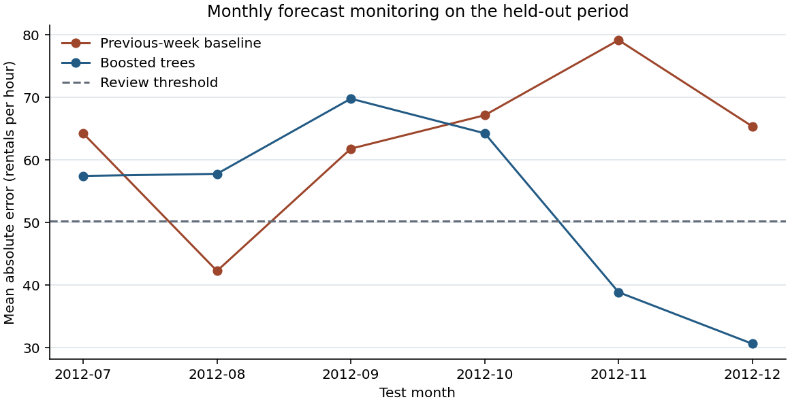

# Hourly bike demand forecasting and monitoring

**Boosted trees reduced held-out MAE by 16.1% against a previous-week baseline** across 4,376 hourly observations. The same model underpredicted demand by an average of 23.4 rentals per hour and lost to the seasonal baseline in August and September. Monthly monitoring exposed failure modes that the aggregate score concealed.



## Forecast contract

At the beginning of hour t, predict total Capital Bikeshare rentals during that hour. The backtest assumes that observed counts through hour t−1 are available at forecast time. Calendar variables are known when the forecast is issued.

- **Data.** The UCI Bike Sharing hourly file contains 17,379 timestamped records for 2011–2012. The 17,544-hour nominal calendar has 165 absent hours. Missing archive records remain unobserved. An exact timestamp lookup leaves an unavailable lag missing rather than substituting the previous available row.
- **Features.** Use hour, weekday, month, weekend, and rental counts from 1, 2, 3, 24, 48, and 168 hours before prediction. A recent mean summarizes up to three available past hours. The same-hour casual and registered rentals are components of the outcome. They are excluded along with same-hour realized weather.
- **Chronology.** Fit on 2011, tune three candidate configurations on January–June 2012, and evaluate the frozen model on July–December 2012. Each simulated future decision may use earlier test-period labels once available, because this is a one-hour-ahead replay. Model weights stay fixed during the replay.
- **Baselines.** Previous-hour persistence and previous-week same-hour demand each use a training-only weekday/hour median when the corresponding lag is missing.

## Held-out results

| Model | MAE | RMSE | Mean signed error | WAPE |
| --- | ---: | ---: | ---: | ---: |
| Previous hour | 86.05 | 130.18 | +0.05 | 33.9% |
| Previous week | 63.16 | 107.97 | +6.68 | 24.9% |
| Boosted trees | **52.99** | **90.86** | **−23.42** | **20.9%** |

Errors are predicted minus observed, in rentals per hour. WAPE divides summed absolute error by summed demand. September is a concrete example of the operational tradeoff. The model's MAE was 69.7 versus 61.8 for the previous-week baseline, with a signed error of −41.6 rentals per hour.

The monitor records observed and nominal hours, missing previous-hour lags, mean demand, signed error, and baseline skill. A review flag fires above 1.25 times aggregate validation MAE. That is an illustrative operating threshold, without a statistical false-alarm guarantee. It flagged July through October. In a deployed system, label availability and the cost of underforecasting would shape the alert. Seasonal demand and predictive errors can move together without identifying the cause of underprediction.

## Reproduce and score

Python 3.12 on Linux or WSL. The first run downloads the UCI release and verifies its checksum.

```bash
python3 -m venv .venv
source .venv/bin/activate
python -m pip install -r requirements.txt
python -m unittest discover -s tests -v
OMP_NUM_THREADS=2 python forecast.py train --output results/local --model-out results/local/model.joblib
```

The scoring command accepts strictly earlier hourly counts. This example uses synthetic input counts for the requested hour.

```bash
cat > results/local/example-history.csv <<'CSV'
timestamp,count
2012-12-20 16:00,330
2012-12-27 13:00,295
2012-12-27 14:00,302
2012-12-27 15:00,320
CSV

python forecast.py score --model results/local/model.joblib \
  --history results/local/example-history.csv --target '2012-12-27 16:00'
```

## Example walkthrough

Draw the prediction timeline and explain why a random split or a simple row-based lag can hide leakage or misalign observations. Walk through September and describe how an alert could trigger a freshness check, baseline comparison, and investigation of underprediction before deciding to retrain. Extend the analysis by simulating a two-hour label delay. Modify the available lags and report how much skill remains with persistence removed.

## Source

Fanaee-T, H. (2013). *Bike Sharing*. UCI Machine Learning Repository. DOI 10.24432/C5W894. [Dataset and CC BY 4.0 terms](https://archive.ics.uci.edu/dataset/275/bike+sharing+dataset).
