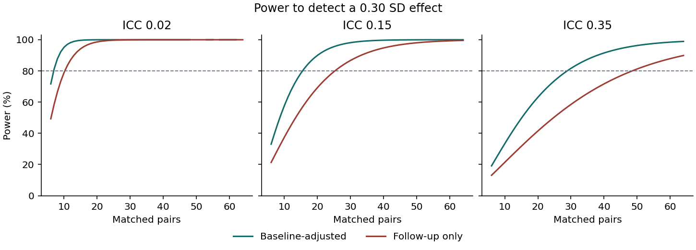

# Design and power a matched-pair cluster experiment

**At a site ICC of 0.15, the naive participant-level test rejected a true null 34.0% of the time.** The two analyses that respected the matched-pair design rejected it 4.4% and 4.7% of the time, against a 5% target. For a true effect of 0.30 SD, prespecified baseline adjustment raised simulated power from 69.4% to 89.6% at the same site count.



## Decision

A multi-site pilot will assign one site in each matched pair to an intervention. Each site enrolls 30 participants. How many sites are needed for 80% power to detect a 0.30 SD increase in a continuous follow-up outcome, and how should the treatment effect be analyzed?

| Site ICC | Smallest tested design with ≥80% power, follow-up only | Smallest tested design with ≥80% power, adjusted |
| ---: | ---: | ---: |
| 0.02 | 11 pairs / 22 sites | 7 pairs / 14 sites |
| 0.15 | 26 pairs / 52 sites | 16 pairs / 32 sites |
| 0.35 | 49 pairs / 98 sites | 29 pairs / 58 sites |

Design sizes are selected from the checked-in grid. At ICC 0.15 with 16 pairs, baseline-adjusted power is 81.5%. The estimate assumes the planning effect, 30 complete observations per site, and the baseline correlation and matching quality specified below. A weaker baseline or fewer completed measurements changes the answer.

## Statistical design

- **Assignment and estimand.** Randomize one site within each matched pair. The design targets the mean effect on a standardized continuous follow-up outcome. Site sizes are equal, so the equally weighted site contrast also weights participants equally in the simulation.
- **Dependence.** Baseline and follow-up outcomes are Gaussian with unit marginal control variance. The site ICC is the sum of a shared pair component (30% of ICC) and a site-specific component (70%). Individual residuals have variance 1 − ICC. Baseline–follow-up correlation is 0.65 for the same experimental unit. Each arm has 20 sites in the simulation and the size grid varies the number of matched pairs.
- **Analysis.** Compare participant-level Welch tests, paired site mean differences, and paired site mean differences adjusted by subtracting 0.65 times the baseline difference. The adjustment is fixed using the design assumption. In a real study, a historical pilot could inform it before randomization.
- **Efficient simulation.** Under the Gaussian model, site means and within-site residual sums of squares are independent. The simulation draws these sufficient statistics directly. The naive analysis reconstructs the participant-level variance from within-site and between-site sums of squares.
- **Analytical check.** If the residual site-mean variance after removing the shared pair term is v, the within-pair follow-up contrast has variance 2v. Baseline adjustment reduces that to 2v × (1 − 0.65²). The normal pair differences give exact noncentral t power under the design assumptions.

## Operating characteristics

| ICC | Participant Welch false positives | Paired follow-up false positives | Baseline-adjusted false positives |
| ---: | ---: | ---: | ---: |
| 0.02 | 9.1% | 4.4% | 4.1% |
| 0.15 | 34.0% | 4.4% | 4.7% |
| 0.35 | 50.0% | 5.4% | 5.1% |

Each cell uses 4,000 simulated trials. The CSV includes Monte Carlo uncertainty, bias, standard errors, and coverage. At ICC 0.15 the naive mean standard error under the null was about 0.058 SD, while the estimate varied about 0.114 SD across trials. That gap explains the inflated rejection rate.

The design is a planning example with synthetic data. It assumes equal cluster sizes, complete data, Gaussian outcomes, no spillover between sites, and a constant treatment effect. A live design should vary those assumptions and use historical estimates where available.

## Reproduce

Python 3.12 on Linux or WSL.

```bash
python3 -m venv .venv
source .venv/bin/activate
python -m pip install -r requirements.txt
python -m unittest discover -s tests -v
python design.py --output results/local
```

## Example walkthrough

Explain why the site determines randomization, why the paired t analysis uses the number of pairs for its degrees of freedom, and why the participant-level standard error was too small. Then change the site size from 30 to 60 and recalculate power. Compare it with adding sites at the original site size. The variance formula shows why increasing enrollment within the same site has diminishing returns when the ICC is high.
