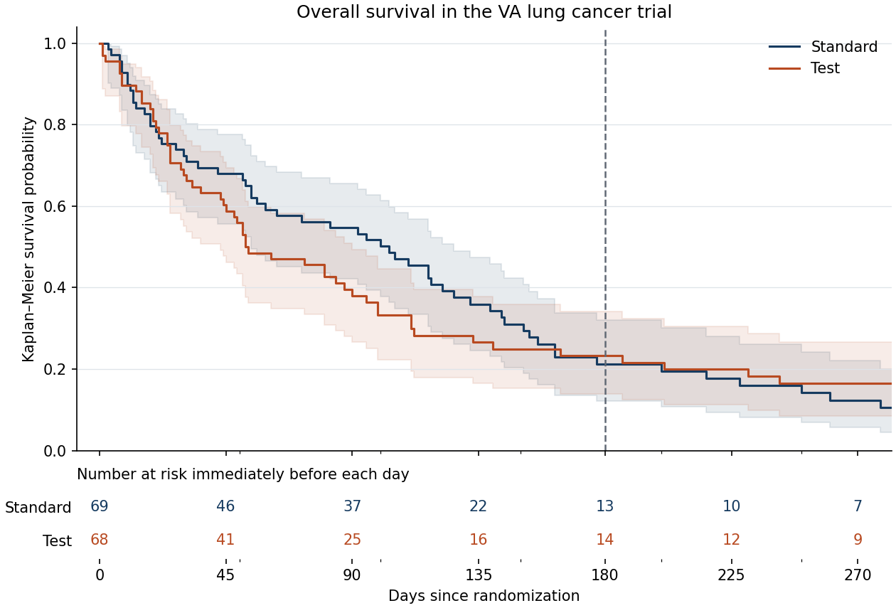

# Clinical trial survival analysis with RMST

**The test arm averaged an estimated 13.8 fewer days alive through day 180** in this retrospective analysis of a randomized VA lung cancer trial. The 95% confidence interval ranged from 35.7 fewer to 8.2 more days. The wide interval leaves substantial uncertainty about the treatment difference.

The project defines a clinical estimand, analyzes 137 participants in the archived trial, and evaluates interval performance against known truth in 12,000 simulated trials. The analysis is written in Python, with an independent Kaplan–Meier integration check against `lifelines`.



## Trial results

| Horizon | Standard RMST | Test RMST | Test − standard | 95% CI |
| ---: | ---: | ---: | ---: | ---: |
| 90 days | 62.8 days | 56.5 days | −6.3 days | [−17.4, 4.8] |
| **180 days** | **95.4 days** | **81.6 days** | **−13.8 days** | **[−35.7, 8.2]** |
| 270 days | 111.0 days | 98.9 days | −12.2 days | [−43.3, 19.0] |

The treatment-only Cox hazard ratio was **1.02** (95% CI **0.71–1.45**). The rank-time proportional hazards diagnostic gave **p = 0.085**, with limited power in this sample. RMST gives the cumulative difference in days alive over the selected window. The Cox model summarizes the relative instantaneous hazard across observed event times. At day 270, risk sets had fallen to seven standard-arm and nine test-arm patients, and the longer-horizon RMST interval is wider.

## Simulation results

| Scenario | True difference | Average estimate | Bias | 95% interval coverage |
| --- | ---: | ---: | ---: | ---: |
| Null, independent censoring | 0.00 days | +0.02 days | +0.02 days | 94.5% |
| Proportional benefit | +18.02 days | +18.11 days | +0.09 days | 94.4% |
| Early harm, late benefit | −9.21 days | −9.16 days | +0.05 days | 95.3% |
| Null, informative censoring | 0.00 days | +9.31 days | +9.31 days | 84.4% |

All 3,000 trials per scenario supported estimation through day 180. Under early harm followed by late benefit, the true survival curves crossed near day 127, while the area through day 180 still favored standard treatment. Under informative censoring, preferential loss of high-risk test patients overstated test-arm survival and reduced coverage. Those results apply to the simulated mechanism. The VA archive leaves its censoring mechanism uncertain.

## Reproduce on Ubuntu, WSL, or macOS

The analysis was verified with Python 3.12. The first run downloads the pinned trial dataset and verifies its checksum.

```bash
python3 -m venv .venv
source .venv/bin/activate
python -m pip install -r requirements.txt
python -m unittest discover -s tests -v
python analysis.py --output results/local
```

The command writes the survival figure, risk table, RMST estimates, Cox diagnostics, and simulation outputs. Use `--replicates`, `--per-arm`, and `--seed` to explore the Monte Carlo design.

- [Analysis design and assumptions](docs/analysis-design.md)
- [Data provenance and dictionary](data/README.md)
- [Technical interview walkthrough and exercises](docs/interview-walkthrough.md)
- [Reproduced results](results/)
