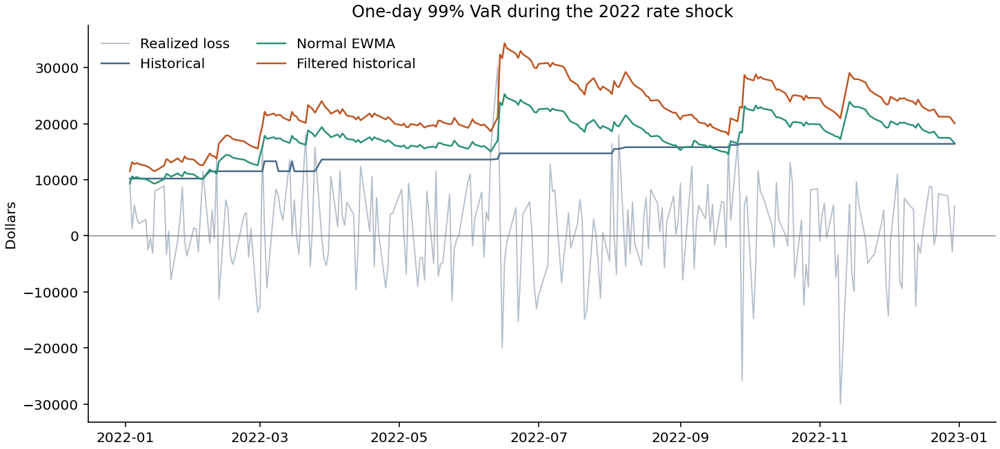

# Walk-forward Treasury value-at-risk backtest

**Filtered historical simulation recorded 28 exceptions over 2,501 forecast days**, an exception rate of 1.12% for a nominal 1% tail. Historical simulation recorded 39 exceptions and Gaussian EWMA recorded 45. Gaussian EWMA nevertheless had the lowest overall quantile loss. The preferred model depends on whether exceedance calibration or the quantile score is the operating priority.



## Research question

Can a volatility-adjusted empirical tail forecast remain calibrated across quiet and stressed Treasury markets?

The U.S. Treasury's 1990–2024 daily par yield archive supplies the 2-, 5-, and 10-year constant maturity yields. The fixed exposures are $200, $300, and $500 of loss per basis-point increase, respectively. The daily loss proxy is the sum of exposure times yield change in basis points. This measures first-order curve sensitivity and omits carry, convexity, execution, financing, and actual instrument pricing.

Dates are sorted and checked for uniqueness. One fully unquoted date, October 11, 2010, is dropped before computing differences. A partially missing selected curve raises an error. Forecast horizons run from one available Treasury observation to the next.

## Forecast and evaluation

1. **Historical simulation** estimates the 99th percentile of losses over the previous 500 observations.
2. **Gaussian EWMA** multiplies the one-step EWMA volatility by the 99th percentile of a standard normal variable. Its decay is 0.94, with a minimum burn-in of 25 observations and a zero conditional mean.
3. **Filtered historical simulation** standardizes each past loss by the volatility forecast available before that loss occurred, takes the empirical 99th percentile of the last 500 standardized shocks, then scales by current forecast volatility.

All three methods predict day t using losses observed by t−1. The exercise uses 2015–2024 as the walk-forward evaluation window. Parameters are fixed for comparison. The historical data were already public when this retrospective exercise was designed. Two stress windows, 2020 and 2022, are included as descriptive slices.

| Model | Exceptions | Exception rate | Coverage p | Independence p | Quantile loss |
| --- | ---: | ---: | ---: | ---: | ---: |
| Historical | 39 | 1.56% | 0.009 | 0.149 | $155.34 |
| Gaussian EWMA | 45 | 1.80% | <0.001 | 0.836 | **$148.01** |
| Filtered historical | 28 | **1.12%** | 0.555 | 0.426 | $150.92 |

The Kupiec likelihood-ratio test assesses the exception frequency. The Christoffersen independence test assesses dependence between consecutive exception indicators. At a 1% nominal tail, annual exception counts are sparse and chi-square approximations can be imprecise. A large p-value is compatible with good calibration and also with alternatives the test has limited power to detect. Quantile loss penalizes both exceedances and overly conservative forecasts.

During the 2022 rate shock, historical simulation had 12 exceptions in 249 days, Gaussian EWMA had nine, and filtered historical simulation had one. Filtered historical's mean threshold was about $22,262, versus $14,243 for historical simulation. Coverage and the implied size of the risk buffer both matter.

## Reproduce

Python 3.12 on Linux or WSL. The source archive is downloaded and checksum-verified on the first run.

```bash
python3 -m venv .venv
source .venv/bin/activate
python -m pip install -r requirements.txt
python -m unittest discover -s tests -v
python backtest.py --output results/local
```

## Interview walkthrough

Derive the dollar loss for a 10 bp increase at the 10-year point. Trace exactly which losses can affect a forecast at time t. Explain why a volatility estimate that updates rapidly can still understate the tail when standardized shocks are heavy-tailed. Compare the models using coverage, consecutive exceptions, mean thresholds, and quantile loss. Then shorten the historical window to 250 days and explain the tradeoff between adaptation and having enough observations to estimate a 99th percentile.

## References

- [U.S. Treasury historical CSV archive](https://home.treasury.gov/interest-rates-data-csv-archive/)
- [Christoffersen, Evaluating Interval Forecasts](https://users.ssc.wisc.edu/~behansen/718/Christoffersen1998.pdf)
